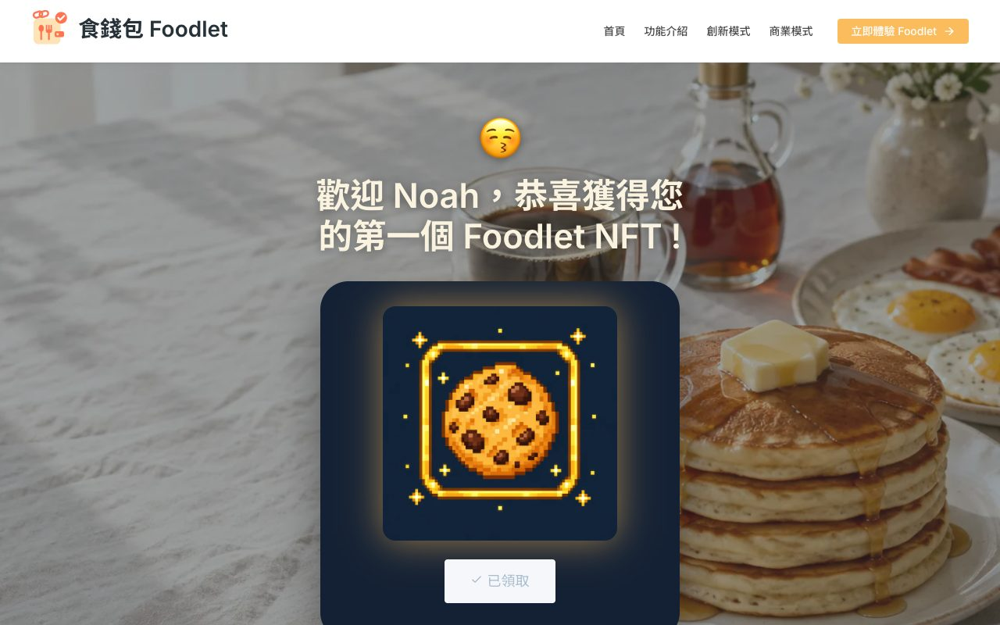

# 食錢包 Foodlet — 餐飲 × 數位錢包支付體驗（互動 Demo）

依 Figma 設計稿實作的行銷網站，加上「註冊 → 載入 → 領取第一個 NFT」的體驗流程，作為 UI/UX 作品集的互動 Demo。

**線上 Demo：https://hr1007.github.io/foodlet/**

> 這是 Demo：註冊與 NFT 皆在瀏覽器端模擬，資料只存在你的瀏覽器（localStorage），不會建立帳號或寄信。
> 網站上的照片與插圖皆為 AI 生成（Figma AI · gpt-image），不使用原設計稿中的第三方照片、GIF 與插圖素材；合作夥伴為虛構品牌。


## 頁面

| 路由 | 內容 |
|---|---|
| `#/` 首頁 | Hero、一站式整合、區塊鏈 × NFT、目標用戶、數據（數字遞增）、NFT 展示、Web2 → Web3 文章、FAQ 手風琴、合作夥伴 |
| `#/features` 功能介紹 | 動態營養圖表、三大功能、NFT 手機 |
| `#/innovation` 創新模式 | 3D 翻轉的 Foodlet 代幣、為什麼愛上 Foodlet、區塊鏈技術、進化藍圖 |
| `#/business` 商業模式 | 噴射背包人物飛入、四種代幣化模式、數據、合作夥伴 |
| `#/join` 立即體驗 | 註冊表單（即時驗證）→ 載入動畫 → 第一個 NFT：待領取 → 領取中 → 已領取 |

| | |
|---|---|
|  |  |


## 動畫

以 [Motion](https://motion.dev) 搭配 CSS 實作，原稿中的 Lottie／GIF 全部改為程式動畫：

- 頁面切換淡入、捲動進場（依序 60ms stagger）、導覽列底線以 `layoutId` 滑動
- 營養長條圖由下長出＋趨勢線描繪（SVG）、代幣 3D 翻轉、噴射背包人物彈簧飛入＋懸浮與速度線
- NFT 領取：呼吸光暈 → 按鈕 loading → 彈簧切換「已領取」＋星星散開
- 全站遵守 `prefers-reduced-motion`：保留淡入、移除位移與循環動畫

## 技術

- Vite + React + TypeScript、`react-router` HashRouter（GitHub Pages 無 SPA fallback）
- `src/styles/tokens.css`：色彩、字級、間距取自 Figma Colors／Typography／Buttons frame
- 文案集中在 `src/content/`
- 圖示：lucide-react

## 開發

```bash
npm install
npm run dev      # 本機預覽
npm run build    # 型別檢查 + 打包到 dist/
npm run deploy   # build 後推到 gh-pages 分支，GitHub Pages 從該分支提供網站
```
